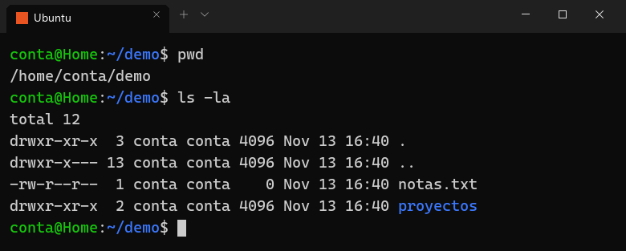

# Comandos Básicos de Linux

En esta guía explico los comandos de Linux que más se usan al empezar con la terminal: moverse entre carpetas, trabajar con archivos, ver lo que tienen dentro y cambiar permisos. Está pensada para alguien que no ha usado nunca la terminal o la ha usado muy poco.

## Índice

- [1. Introducción](#1-introducción)
- [2. Requisitos previos](#2-requisitos-previos)
- [3. Navegar por las carpetas](#3-navegar-por-las-carpetas)
- [4. Crear, copiar, mover y borrar archivos](#4-crear-copiar-mover-y-borrar-archivos)
- [5. Ver el contenido de un archivo](#5-ver-el-contenido-de-un-archivo)
- [6. Cambiar permisos y propietarios](#6-cambiar-permisos-y-propietarios)
- [7. Práctica paso a paso](#7-práctica-paso-a-paso)
- [8. Buscar archivos y texto](#8-buscar-archivos-y-texto)
- [9. Resolución de problemas](#9-resolución-de-problemas)
- [10. Referencias](#10-referencias)

---

## 1. Introducción

Al principio la terminal echa un poco para atrás, pero con pocos comandos ya se puede hacer casi todo lo del día a día. Además, muchos servidores no tienen entorno gráfico, así que ahí la terminal es la *única* forma de trabajar.

## 2. Requisitos previos

Para seguir la guía hace falta:

- Linux instalado (por ejemplo Ubuntu), aunque también vale una máquina virtual o WSL en Windows, que es lo que uso yo habitualmente.
- Una terminal abierta. En Ubuntu se abre con `Ctrl + Alt + T`.
- Un usuario que pueda usar `sudo`, solo para el apartado 6.

> Ojo: Linux distingue mayúsculas y minúsculas, así que `Notas.txt` y `notas.txt` son dos archivos distintos.

## 3. Navegar por las carpetas

Lo primero en la terminal es saber dónde estás y cómo moverte de una carpeta a otra. 
Para eso hay cuatro comandos:

- `pwd`: te dice la ruta de la carpeta en la que estás.
- `ls`: enseña los archivos y carpetas que hay en el directorio actual.
- `cd`: sirve para entrar en otra carpeta.
- `realpath`: te da la ruta completa de un archivo o carpeta, empezando desde `/`.

### Ejemplos

```bash
pwd                  # Muestra ruta actual
ls -la               # Muestra todos los archivos (incluido ocultos)
cd /etc              # Entra en la carpeta /etc
cd ..                # Vuelve a la carpeta anterior
cd ~/demo            # Entra en la carpeta demo de tu usuario
realpath notas.txt   # Muestra la ruta completa de notas.txt
```

`ls -la` es bastante útil porque, además de los archivos ocultos, 
te enseña los permisos y el propietario de cada uno.



En la captura primero sale la ruta con `pwd` y después el listado con `ls -la`. Lo que aparece en la primera columna (`drwxr-xr-x` y parecidos) son los **permisos**, que explico en el apartado 6.

`realpath` es de mis favoritos. Si estás en `/home/conta/demo` y escribes `realpath notas.txt`, te devuelve `/home/conta/demo/notas.txt`, que viene muy bien cuando tienes que copiar la ruta de un archivo para usarla en otro comando o en un script.

## 4. Crear, copiar, mover y borrar archivos

Cuando ya sabes moverte por las carpetas, el siguiente paso es trabajar con archivos. 
Estos son los comandos básicos:

| Comando | Para qué sirve                          | Ejemplo                    |
| ------- | --------------------------------------- | -------------------------- |
| `mkdir` | Crea una carpeta nueva.                 | `mkdir proyectos`          |
| `touch` | Crea un archivo vacío.                  | `touch notas.txt`          |
| `cp`    | Copia un archivo.                       | `cp notas.txt backup.txt`  |
| `mv`    | Mueve o cambia el nombre de un archivo. | `mv notas.txt documentos/` |
| `rm`    | Borra un archivo.                       | `rm notas.txt`             |

Por ejemplo, para tener una carpeta donde guardar los trabajos basta con `mkdir proyectos`, y luego con `cp` y `mv` puedes ir copiando, moviendo o renombrando lo que metas dentro.

> Cuidado con `rm -rf`. Borra la carpeta con todo lo que tenga dentro, 
> no pide confirmación y no pasa por la papelera. Antes de darle a Enter revisa bien la ruta.

## 5. Ver el contenido de un archivo

Para leer un archivo de texto o mirar los registros del sistema no hace falta abrir un editor. 
Con estos comandos es suficiente:

- `cat` saca todo el contenido de golpe.
- `less` lo enseña poco a poco, que viene bien con archivos largos. Se sale pulsando `q`.
- `head` muestra solo las primeras líneas.
- `tail` muestra las últimas.

### Ejemplo práctico

```bash
cat /etc/passwd
tail -n 20 /var/log/syslog
```

Con el primero ves `/etc/passwd`, que es donde se guardan las cuentas de usuario del sistema.

El segundo te enseña ***las últimas*** 20 líneas del registro del sistema. Este archivo no existe en todas las distribuciones; si no lo tienes, los registros se miran con `journalctl`.

## 6. Cambiar permisos y propietarios

En Linux cada archivo tiene permisos que dicen quién puede leerlo, modificarlo o ejecutarlo. 
Los dos comandos que se usan para esto son:

- `chmod`, para cambiar los permisos de lectura (`r`), escritura (`w`) y ejecución (`x`).
- `chown`, para cambiar el propietario o el grupo del archivo.

### Qué significa cada permiso

| Letra | Permiso   | En un archivo permite...     |
| ----- | --------- | ---------------------------- |
| `r`   | Lectura   | Ver su contenido.            |
| `w`   | Escritura | Modificar su contenido.      |
| `x`   | Ejecución | Ejecutarlo como un programa. |

### Ejemplo

```bash
# Activar el permiso de ejecución a un script
chmod +x script.sh

# Cambiar el propietario y el grupo de un archivo
sudo chown admin:admin archivo.txt
```

La primera línea le da a `script.sh` permiso de ejecución, que sin él no se puede lanzar con `./script.sh`.

La segunda pone como propietario y grupo del archivo a `admin`. Lleva `sudo` delante porque cambiar el propietario normalmente solo lo puede hacer el administrador.

## 7. Práctica paso a paso

Para practicar lo anterior se puede hacer este ejercicio, 
que se queda en la carpeta personal y no toca nada del sistema:

1. Ve a tu carpeta personal con `cd ~` y comprueba dónde estás con `pwd`.
2. Crea una carpeta llamada `practica` con `mkdir practica` y entra con `cd practica`.
3. Crea un archivo vacío con `touch notas.txt`.
4. Haz una copia con `cp notas.txt backup.txt`.
5. Lista el contenido con `ls -l` y comprueba que salen los dos archivos.
6. Borra la copia con `rm backup.txt`.
7. Sal con `cd ..` y borra la carpeta entera con `rm -r practica`.

Todo seguido quedaría así:

```bash
cd ~
pwd
mkdir practica
cd practica
touch notas.txt
cp notas.txt backup.txt
ls -l
rm backup.txt
cd ..
rm -r practica
```

## 8. Buscar archivos y texto

Cuando hay muchas carpetas, buscar algo a mano con `ls` es un rollo. Para eso están `find`, que busca archivos por su nombre, y `grep`, que busca texto dentro de los archivos.

| Comando | Qué busca                          | Ejemplo                       |
| ------- | ---------------------------------- | ----------------------------- |
| `find`  | Archivos y carpetas por su nombre. | `find ~ -name "notas.txt"`    |
| `grep`  | Líneas que contienen un texto.     | `grep "conta" /etc/passwd`    |

### Ejemplos

```bash
find ~ -name "*.txt"          # Todos los .txt de tu carpeta personal
find /etc -name "*.conf"      # Archivos de configuración dentro de /etc
grep -i "error" registro.log  # Líneas con "error", sin importar mayúsculas
grep -r "ssh" /etc            # Busca "ssh" en todos los archivos de /etc
```

En `find`, el asterisco (`*`) vale por cualquier texto, así que `"*.txt"` encuentra todo lo que termine en `.txt`. Las comillas hacen falta para que la terminal no lo cambie antes de tiempo.

Con `grep`, la opción `-i` hace que no distinga mayúsculas y minúsculas, y `-r` busca dentro de una carpeta y todas sus subcarpetas.

> Si buscas en carpetas del sistema como `/etc` te pueden salir mensajes de `Permission denied`. No es un fallo del comando, son carpetas que tu usuario no puede leer.

---

## 9. Resolución de problemas

Estos errores son bastante típicos cuando empiezas:

| Mensaje de error                    | Por qué pasa                                    | Cómo arreglarlo                                   |
| ----------------------------------- | ----------------------------------------------- | ------------------------------------------------- |
| `No such file or directory`         | La ruta o el nombre del archivo están mal.      | Mirar con `ls` y revisar las mayúsculas.          |
| `Permission denied`                 | Tu usuario no tiene permisos sobre el archivo.  | Usar `sudo` o cambiar permisos con `chmod`.       |
| `command not found`                 | El comando está mal escrito o no instalado.     | Revisar cómo está escrito o instalarlo con `apt`. |
| `rm: cannot remove: Is a directory` | Has intentado borrar una carpeta con `rm` solo. | Usar `rm -r`, con cuidado.                        |

> Si no te acuerdas de cómo va un comando, `man ls` o `ls --help` te enseñan todas sus opciones. 
> Funciona con casi cualquier comando.

## 10. Referencias

- [Ubuntu - The Linux command line for beginners](https://ubuntu.com/tutorials/command-line-for-beginners)
- [GNU Coreutils - Manual oficial](https://www.gnu.org/software/coreutils/manual/)
- [Linux man pages online](https://man7.org/linux/man-pages/)
